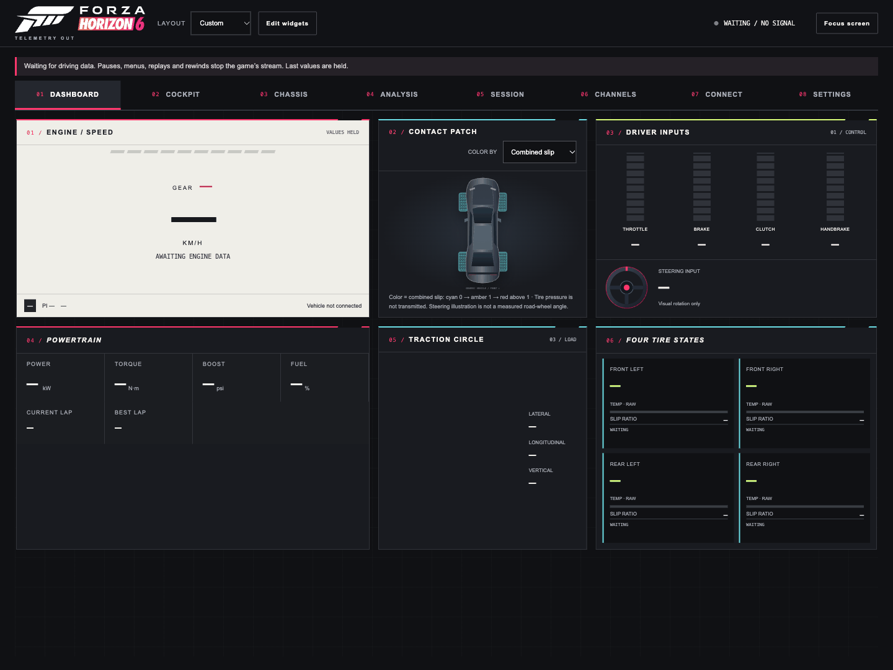
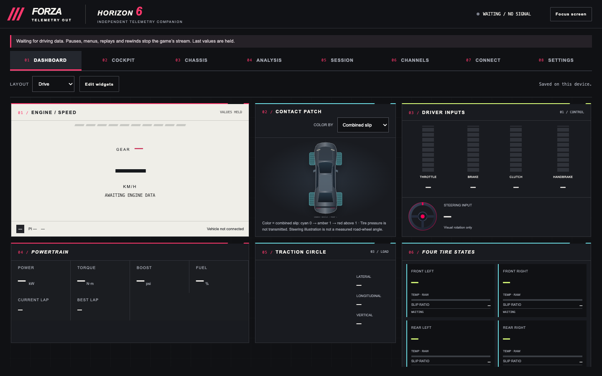
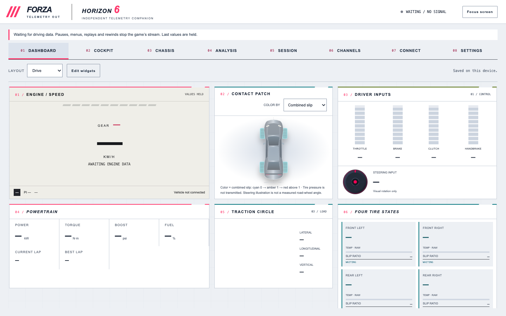
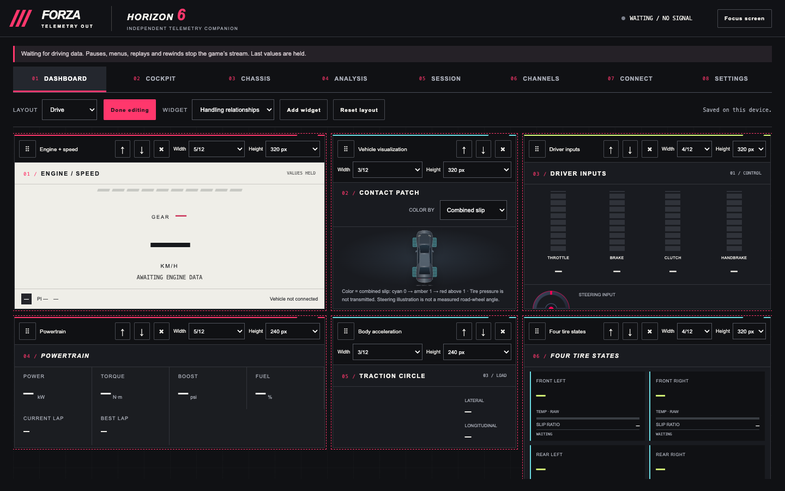
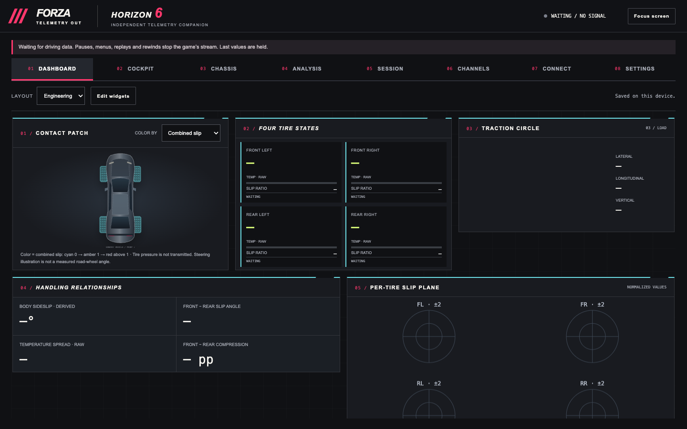
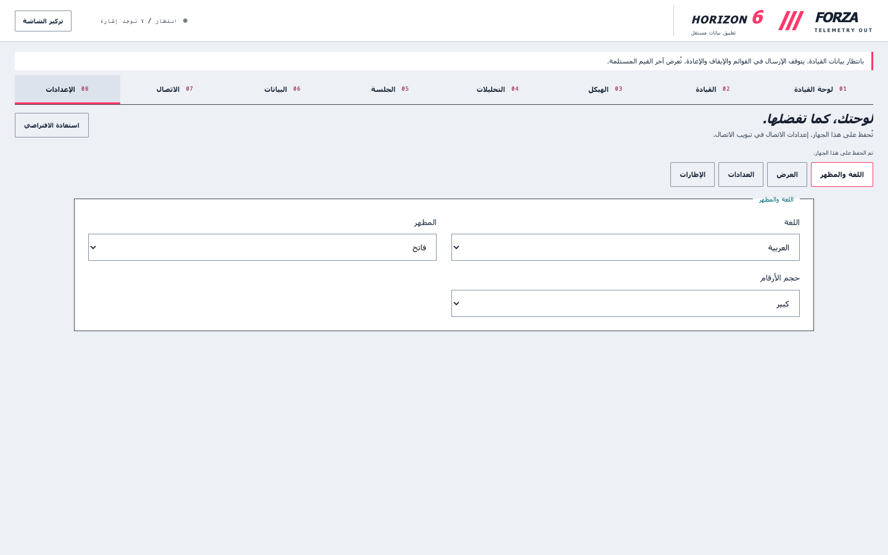
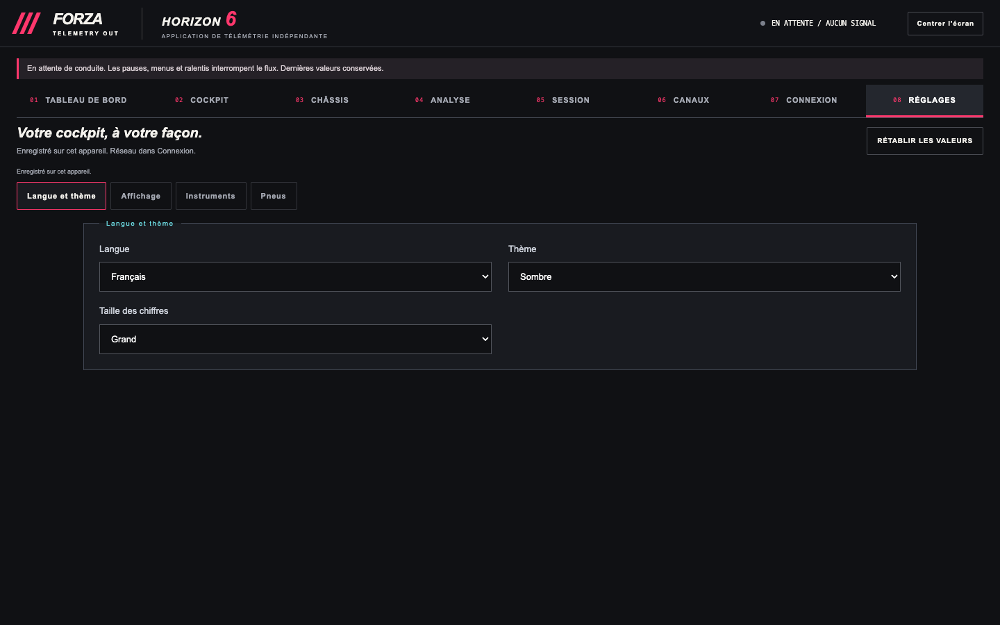
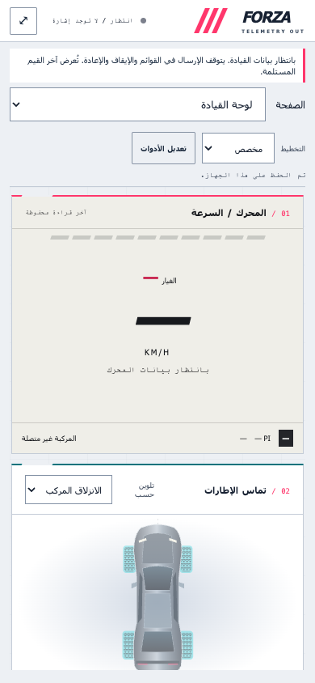
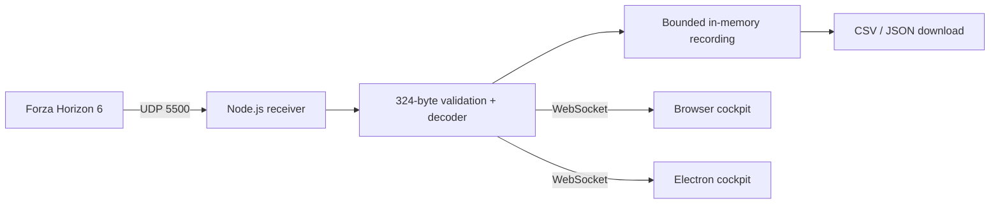

<p align="center"></p>

# Forza Telemetry Out

An independent **Forza Horizon 6** telemetry cockpit for your desktop and browser. See what the car is doing: inputs, engine output, grip, suspension, acceleration, motion and race timing. Inspect and export **all 88 documented fields** from the game's 324-byte UDP packet.

[Getting started](GETTING_STARTED.md) · [Documentation](docs/README.md) · [Every packet field](docs/PROTOCOL.md) · [Analytics](docs/ANALYTICS.md) · [Changelog](CHANGELOG.md) · [Build & release](docs/RELEASING.md) · [MIT license](LICENSE)


[](https://github.com/sahmedhusain/forza-telemetry-out/actions/workflows/ci.yml)

**Desktop + web · 26 widgets · 88 raw fields · 4 interface languages · dark/light themes · CSV/JSON exports**



The animation shows the current app waiting for a game connection. [Static dashboard PNG](docs/assets/dashboard.png) · [Screenshot gallery](#screenshots). No generated driving data is shown.

> Fan-made companion, not an official Forza product. Forza, Horizon, Xbox and related names belong to their respective owners. The application mark and animation are original companion artwork; no official endorsement is implied.

## Start in two minutes

Install [Node.js](https://nodejs.org/) 22 or later, then:

```sh
git clone https://github.com/sahmedhusain/forza-telemetry-out.git
cd forza-telemetry-out
npm ci
```

Create your local `.env` from [.env.example](.env.example) ([Windows/macOS/Linux commands](GETTING_STARTED.md#install-from-source)). Keep local configuration out of commits. Start **one** receiver:

```sh
npm start          # browser dashboard and receiver
npm run electron  # desktop app with the receiver built in
```

For the browser, open **http://127.0.0.1:3050**. The dashboard waits for real driving packets; there is no demo or audio feature.

In FH6, go to **Settings → HUD and Gameplay**, turn **Data Out On**, set the destination IP to this computer's IPv4 address and the port to **5500**. On the same gaming PC use `127.0.0.1`; from Xbox or another PC use the receiver's LAN IP. Allow inbound UDP 5500 on the receiver, then drive. Ports **5200–5300 must be avoided**.

The game sends only while actively driving. Menus, pauses, replays, rewinds and finished races stop the stream. The dashboard marks held values after two seconds without a frame. [Official setup and packet documentation](https://support.forza.net/hc/en-us/articles/51744149102611-Forza-Horizon-6-Data-Out-Documentation).

## Your customizable dashboard

Dashboard is the default home page. It offers **26 widgets**, including engine/speed, powertrain, inputs, car/tire state, G-force, charts, current timing, laps, vehicle metadata, session analytics, all 88 raw channels, historical records, recording controls and connection health. Existing detail tabs remain available.

1. Choose **Drive**, **Engineering** or **All widgets** as a starting layout.
2. Click **Edit widgets**. Drag the grip to reorder on desktop, or use **↑ / ↓** on touchscreens and keyboards.
3. Choose **Width** (columns out of 12) and **Height** for each widget. Phones stack widgets at full width and retain the saved desktop widths.
4. Use **×** to hide a widget, or choose one in the widget picker and click **Add widget**.
5. Click **Done editing**. Layout changes save automatically on this browser/device. **Reset layout** restores Drive; telemetry/history/recordings are preserved.

The overview scrolls internally with hidden tracks. Focus the widget grid and use Page Up/Down, or use wheel/touch gestures. The current widget selection, order and dimensions use `forza.dashboard.v1` in localStorage; storage failures are shown and the layout remains usable for the session. Each browser/device has its own layout.

The refreshed companion identity uses an original animated slash mark, numbered panels and colored subsystem accents. Layout changes animate; tire tread motion follows each reported angular velocity and stops with stale/inactive data. Reduced-motion settings disable decorative/tread motion. These remain illustrations, with raw numbers available alongside them.

## Tabs, customization and connection

Choose Dashboard, Cockpit, Chassis, Analysis, Session, Channels, Connect or Settings, then a smaller screen inside that view. Cockpit separates instruments, inputs, motion and vehicle metadata; Chassis separates the car and each axle. Connection, settings and session tools are split too. Phones use labeled View/Screen selectors. Scroll gestures and keyboard scrolling still work; scrollbar tracks stay hidden.

Settings persist per device: language, dark/light/system theme, number size, units, accent, density, instrument style, motion, G-scale, history window, visual shift threshold and tire colors. Connect shows detected receiver IPs, active UDP/TCP ports and packet health; apply a new UDP port without restarting, then download .env to preserve it. Read the [analytics guide](docs/ANALYTICS.md) for formulas and limitations.

### Inspect related signals

In **Analysis → Compare channels**, choose any two of the 88 raw fields. Cyan/solid and amber/dashed traces have explicitly independent axes. Tap the graph or move **Inspect sample** to hold the current window and inspect the same measured instant in both channels. Large values are rounded; **Exact raw** preserves the full numeric value. **Resume live** releases the snapshot. Reception, recording and other instruments continue while a channel window is held. Browser review remains bounded to 120 seconds / 1,200 samples; it is separate from saved per-car extrema.

Use the header **Focus screen** control to expand the selected screen. The source state and exit button remain visible. Press **Escape** or **Exit focus** to restore navigation. [Research and considered next steps](docs/RESEARCH.md) distinguish implemented features from future work.

### Languages, appearance and readability

Open **Settings → Language and theme** to choose a language:

| Language | Code | Layout | Current screenshot |
|---|---|---|---|
| 🇬🇧 English | `en` | Left to right | [Dark](docs/assets/settings-en-dark.png) |
| 🇸🇦 العربية — Arabic | `ar` | Right to left | [Light / RTL](docs/assets/settings-ar-light.png) |
| 🇪🇸 Español — Spanish | `es` | Left to right | [Light](docs/assets/settings-es-light.png) |
| 🇫🇷 Français — French | `fr` | Left to right | [Dark](docs/assets/settings-fr-dark.png) |

Arabic mirrors navigation and reading order; physical car corners and plot axes retain their physical orientation. Language changes do not rename raw packet fields or change exported data. These are interface translations; repository documentation is in English.

Choose **Dark**, **Light** or **System**, and **Standard**, **Large** or **Extra large** numbers. Preferences persist on this device. Charts change their grid, label and line colors with the theme. Source documentation and low-level network error details remain in their original language.

### Added measured analysis

The per-tire slip plane plots normalized slip angle against slip ratio. Session shows mean lap time, population standard deviation after at least two observed laps, peak longitudinal braking G while the brake is applied, and time-weighted RMS suspension velocity/end-of-travel occupancy. Read the [formulas, eligibility and unavailable calculations](docs/ANALYTICS.md).

## A cockpit, with the data behind it

| Surface | What you see |
|---|---|
| Engine / speed | RPM arc scaled to reported engine maximum, shift lights, gear, km/h or mph |
| Driver inputs | Throttle, brake, clutch, full analog handbrake and signed steering percentage |
| Contact patch | All four tire temperatures (raw), suspension compression, slip ratio, rumble contact |
| Powertrain | kW or hp, torque in N·m, boost in psi, fuel percentage |
| Traction circle | Lateral, longitudinal and vertical G derived from local acceleration |
| Trace | Selectable 10/20/60/120-second window of speed, throttle, brake and boost; normalized scales stated in legend |
| Race / session | Current, best and last lap, elapsed race time, completed laps, position, total distance |
| Body / world | World position, local velocity, orientation, angular velocity, collision loss and object mass |
| All channels | All 88 original fields, byte offsets, units and types; search, group filter and freeze |
| Recording | In-memory capture with complete CSV and JSON downloads |

The raw explorer also exposes wheel rotation, suspension travel in meters, slip angles, combined slip, puddle flags, surface rumble, car group, engine idle RPM, driving line and AI braking difference. Nothing in the documented packet is discarded. The unspecified last byte is retained separately.

No tire-wear or track-ID values are invented: they are absent from this format. Tire temperature units, detailed class names and special gear meanings are not defined by the supplied FH6 document, so these remain raw. See [protocol notes and all offsets](docs/PROTOCOL.md).

## Screenshots

All images below were captured from **1.6.0**. Instruments show the real waiting state until FH6 sends packets. Click an image to open the full PNG; the [complete image index](docs/README.md#current-images) includes all four language settings.

| Drive dashboard · dark | Drive dashboard · light |
|---|---|
| [](docs/assets/dashboard.png) | [](docs/assets/dashboard-light.png) |

| Edit widget layout | Engineering preset |
|---|---|
| [](docs/assets/dashboard-edit.png) | [](docs/assets/dashboard-engineering.png) |

| Arabic · light / RTL | French · dark |
|---|---|
| [](docs/assets/settings-ar-light.png) | [](docs/assets/settings-fr-dark.png) |

<p align="center"><a href="docs/assets/dashboard-phone-ar.png"></a></p>

## Desktop and web: one application



A browser cannot receive UDP directly. The Node process or Electron app must run on the receiving computer. Both serve the same local web assets, with no cloud account and no runtime CDN dependencies. The game receives no commands from this application.

To view from a phone or tablet, set `WEB_HOST=0.0.0.0`, restart, and open `http://RECEIVER_LAN_IP:3050` on the same private network. This gives other devices on that network access to telemetry, exports and recording controls; there are no user accounts. Do not forward these ports to the internet.

## Technology

| | Stack | Role |
|---|---|---|
|  | Electron | Sandboxed desktop window; context-isolated preload |
|  | Node.js | Native UDP, HTTP, binary decoding and test runner |
|  | JavaScript | Shared data flow, analytics and browser controls |
|  | HTML / Canvas | Semantic UI and custom instrument drawing |
|  | CSS | Responsive layouts, racing typography and reduced-motion support |
| ↔ | ws | Local WebSocket broadcast with backpressure limit |
|  | dotenv | Local settings |
|  | electron-builder / GitHub Actions | Platform packaging and release workflow |

README badges/icons require internet; the app itself does not. No frontend framework or chart dependency is required.

## Configuration

| Variable | Default | Meaning |
|---|---|---|
| `FORZA_PORT` | `5500` | UDP receiving port; match the game |
| `FORZA_HOST` | `0.0.0.0` | UDP bind address; receives from LAN |
| `WEB_PORT` | `3050` | HTTP and WebSocket port |
| `WEB_HOST` | `127.0.0.1` | Local browser access; use `0.0.0.0` for trusted LAN |
| `FORZA_DATA_DIR` | Source: `data/`; installed: user-data `data/` | Optional absolute directory for cumulative history |

Environment variables override `.env`. Do not run web and desktop receivers on the same port simultaneously. Port conflicts produce errors rather than silently changing the game destination.

The source app reads `.env` from the working directory. Installed desktop builds first load `.env` from Electron's user-data directory; see [getting started](GETTING_STARTED.md#installed-desktop-builds) for exact paths. Downloading `.env` from Connect includes the four active network settings; retain any custom `FORZA_DATA_DIR` separately. Display preferences and layouts live in browser storage, outside `.env`.

## Recording and exports

1. Open **Session → Recording**, click **Record**, then drive. Live arrival rate follows the game; the dashboard draws at the browser refresh rate.
2. Click **Stop recording**. Use **CSV** or **JSON** to download the session.
3. After saving, use **Clear session** to allow a new recording. Clearing requires confirmation.

Recording stops at **18,000 frames**, approximately five minutes at 60 packets/s, without dropping the beginning. A higher game frame rate fills it faster. Recordings live in memory and disappear when the receiver closes; export before quitting. Raw CSV has 91 columns: recording time offset, source, 88 original fields, and the final byte. JSON includes derived display data as well. The CSV source column is always `live`; it remains present for compatibility with earlier exports.

## Saved bests and vehicle information

**Session → Saved bests** keeps per-car speed, power, torque, RPM and acceleration peaks from every received active-driving packet, even while no browser or recording is open. **History coverage** shows packet counts, observed time/distance and water, curb and slip time. **Field records** shows minimum, maximum and latest values for all 88 fields, filtered by system. Export history downloads every saved car as JSON.

History is saved every five seconds and on clean shutdown to `data/history.json` when running from source, or `<Electron user-data>/data/history.json` when installed. It survives browser reconnects and receiver restarts. This is a cumulative summary, not unlimited raw-packet storage; CSV/JSON recordings remain separate. Data discarded by previous versions cannot be recovered. See [history scope and formulas](docs/ANALYTICS.md#persistent-packet-history).

**Cockpit → Vehicle** shows ordinal, name source, model year when known, class number, PI, drivetrain, cylinders and group. The packet itself has no model-name text. A bundled, attributed [community lookup by HDR](https://gist.github.com/HDR/0659d1717bc61504bf83750628963f4f) covers 681 ordinals; unknown IDs remain visible and names may need correction after game updates. Lap minima can span different events because FH6 supplies no track ID.

## Project map

```text
main.js / preload.js         Electron lifecycle and narrow UI bridge
server/index.js              HTTP, WebSocket and control endpoints
server/parser.js             Validated raw + derived packet decoder
server/udp-listener.js       UDP reception, errors and packet statistics
server/recorder.js           Bounded recording and full-field exports
server/history.js            Persistent per-car extrema and observed totals
public/data/cars.json        Attributed community ordinal-to-name lookup
public/packet-schema.json    Canonical 88-field definitions
public/index.html            Shared cockpit
public/js/                   UI, localization and canvas instruments
public/js/widget-layout.js   Widget registry, validation and presets
public/js/dashboard.js       Shared widget mounting and layout controls
public/css/                  Layouts, themes, instruments and responsive styles
public/assets/               Original logos, icon and chassis drawings
tests/                       Decoder, analytics, history, layout and transport tests
docs/                        Guides, API, releases, screenshots and QA evidence
```

## Development and validation

```sh
npm test                 # decoder, analytics, localization, recorder and local socket tests
npm run package          # unpacked desktop application for your host platform
npm run dist             # platform installers / archives in dist/
```

Socket tests need permission to bind loopback ports. Tests cover all 88 offsets, malformed lengths, non-finite floats, timestamp wrap, signed inputs, puddle integers, FH6's inserted fields, recorder capacity, complete CSV exports, origin rejection, real UDP transport and stale state. Synthetic test fixtures verify calculations; real-game hardware compatibility still needs a driving session. See [validation notes](docs/VALIDATION.md) for what was actually exercised.

The [local HTTP/WebSocket API](docs/API.md) documents receiver status, network settings, history, recording controls and exports. There is no cloud service or game-control endpoint.

## Windows desktop downloads

Build both a Windows x64 Setup installer and a portable executable:

```sh
npm run dist:win
```

Outputs are `dist/Forza-Telemetry-Out-1.6.0-Windows-x64-Setup.exe` and `dist/Forza-Telemetry-Out-1.6.0-Windows-x64-Portable.exe`. The installed desktop app includes the receiver; end users do not need Node.js. Local builds are unsigned. Only distribute artifacts after verifying them on Windows.

Check [GitHub Releases](https://github.com/sahmedhusain/forza-telemetry-out/releases) for uploaded builds and their release notes. Executables are build artifacts and are not committed to the source repository. A source push alone does not publish an installer.

## Version and releases

Current source version: **1.6.0**. The existing 1.0.0 prototype has been updated around the supplied FH6 specification. [Changelog](CHANGELOG.md) records the changes. [Release instructions](docs/RELEASING.md) describe local packaging and the tag-driven Windows/macOS/Linux workflow. No public release or signed installer is claimed merely because a version number exists. [Repository releases](https://github.com/sahmedhusain/forza-telemetry-out/releases).

## Contributing

Report the game version, operating system, packet size and reproducible steps. Do not include private network details or recordings without reviewing them. For decoder changes, update the schema/reference and add a binary fixture assertion. Run `npm test`, inspect desktop and phone layouts, and keep unavailable-data indicators clear. Other Forza games are outside this release's tested scope, even if a packet length happens to match.

## License and attribution

Source code and original companion artwork: [MIT](LICENSE). Third-party brands and icons remain their owners' property and are not relicensed by this repository. Forza identity research: [official Horizon 6 page](https://forza.net/forzahorizon6) and [official reveal](https://forza.net/news/forza-horizon-6-reveal). Packet source: [Forza Support](https://support.forza.net/hc/en-us/articles/51744149102611-Forza-Horizon-6-Data-Out-Documentation). Tech icons: [Simple Icons](https://simpleicons.org/). See [notices](THIRD_PARTY_NOTICES.md).
