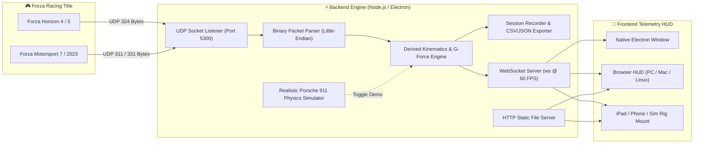

<div align="center">

  

  <br><br>

  <p align="center">
    <strong>Ultra-Responsive 60Hz Telemetry HUD, Real-Time Physics Analytics & Sim Racing Dashboard</strong>
    <br>
    <em>Engineered for Forza Horizon 5, Forza Horizon 4, Forza Motorsport (2023), and Forza Motorsport 7</em>
  </p>

  <p align="center">
    <a href="https://github.com/sahmedhusain/forza-telemetry-out/releases"></a>
    <a href="LICENSE"></a>
    <a href="https://nodejs.org/"></a>
    <a href="https://www.electronjs.org/"></a>
    <a href="https://github.com/sahmedhusain/forza-telemetry-out/stargazers"></a>
    <a href="https://github.com/sahmedhusain/forza-telemetry-out/pulls"></a>
  </p>

  <p align="center">
    
    &nbsp;&nbsp;&nbsp;&nbsp;
    
  </p>

  <p align="center">
    <a href="#-key-features">Key Features</a> •
    <a href="#-live-telemetry-architecture">Architecture</a> •
    <a href="#-quick-start">Quick Start</a> •
    <a href="#-all-84-telemetry-data-points">Packet Specification</a> •
    <a href="#-in-game-setup-guide">In-Game Setup</a> •
    <a href="#-releases--versioning">Releases</a>
  </p>

</div>

---

## ⚡ Tech Stack

<div align="center">

| Component | Technology | Description |
| :--- | :--- | :--- |
| **Desktop Framework** |  **Electron** | Native cross-platform desktop application with hardware acceleration |
| **Backend Engine** |  **Node.js** | Native Little-Endian UDP socket server & HTTP daemon |
| **Real-Time Feed** |  **WebSocket (ws)** | Zero-latency 60 FPS binary-to-JSON broadcast engine |
| **HUD & Visuals** |  **HTML5 / CSS3 / ES6** | Custom Forza Horizon neon & Motorsport titanium design system |
| **Rendering Gauges** |  **HTML5 Canvas 2D** | High-DPI 60 FPS sweeping tachometer, G-meter & timeline charts |
| **Audio Synthesis** |  **Web Audio** | Algorithmic motorsport redline shift-point warning buzzer |

</div>

---

## 🏁 Key Features

### 🏎️ 1. Authentic Forza DNA Visual Design
- **Apex Tachometer & Speedometer HUD**: Sweeping 270-degree high-DPI Canvas tachometer with responsive redline glow, digital numeric readout, and massive gear display (`R`, `N`, `1`..`10`).
- **F1 / GT3 Shift Light Array**: Progressive 10-LED shift light bar (Green ➔ Yellow ➔ Red ➔ Flashing Violet Redline Strobe).
- **Audio Shift Rev Warning**: Built-in synthesized Web Audio tone alerts you the exact millisecond to pull the paddle shifter.
- **Forza Class & PI Badge**: Automatic detection of car classification (`D`, `C`, `B`, `A`, `S1`, `S2`, `X`) with official Forza color coding and Performance Index (`100`–`999`).

### 🛞 2. 4-Wheel Chassis & Tire Telemetry Matrix
- **Real-Time Tire Heatmap**: Dynamic temperature monitoring on all 4 wheels (`FL`, `FR`, `RL`, `RR`) with color progression:
  - 🔵 **Cold** (< 65°C / < 150°F)
  - 🟢 **Optimal Grip** (65°C – 105°C / 150°F – 220°F)
  - 🟡 **Warm** (106°C – 125°C / 221°F – 257°F)
  - 🔴 **Overheating / Degrading** (> 125°C / > 257°F)
- **Suspension Travel Dampers**: Active spring compression meters and suspension travel measurement in millimeters.
- **Tire Slip Ratio & Angle**: Real-time grip loss warning borders that light up when tires exceed traction limits.
- **Rumble Strip & Puddle Detection**: Live indicators for apex curb vibration and surface puddle depth.

### 🌐 3. G-Force Friction Circle (Accelerometer)
- **Friction Ellipse / Circle**: Visualizes combined lateral (cornering) and longitudinal (acceleration/braking) G-forces.
- **Inertia Trail**: Real-time fading trail traces vehicle weight transfer throughout braking zones, apexes, and exits.
- **Numeric G-Readouts**: High-precision readouts for Lateral G, Longitudinal G, and Vertical G with peak hold.

### 🕹️ 4. Driver Inputs & Steering Wheel
- **Pedal Ladder Bars**: Vertical LED indicators for Throttle (0-100%), Brake (0-100%), Clutch (0-100%), and Handbrake.
- **Rotating Steering Wheel**: Graphic steering wheel that rotates up to 900° lock-to-lock matching your direct physical input with live degree readout.

### ⚙️ 5. Powertrain Dyno & Performance Analytics
- **Live Horsepower & Torque**: Instantaneous power (HP / kW) and engine torque (Nm / lb-ft).
- **Turbo Boost Gauge**: Precise boost pressure reading (PSI / Bar) with vacuum/boost transition.
- **Automated 0-100 km/h (0-60 mph) Sprint Timer**: Automatically starts when launching from a stop and captures your best 0-100 sprint time.

### ⏱️ 6. Lap Timing & Session Telemetry
- Current Lap Time, Last Lap Time, Best Lap Time (highlighted in purple), Lap Counter, and Race Position (`P1`).
- Total track distance accumulated during the session.

### 📈 7. Real-Time Timeline Graph
- 60 FPS scrolling multi-channel telemetry chart displaying Speed (Cyan), Throttle (Green), Brake (Red), and Boost (Purple).

### 🕹️ 8. Built-in Realistic Physics Simulator ("Demo Drive")
- Don't have Forza running right now? Click **▶ DEMO DRIVE** to activate the hyper-realistic **Porsche 911 GT3 RS** telemetry generator! Simulates full acceleration through gears 1–6, threshold braking with nose-dive weight transfer, trail braking into high-G corners, curb clipping, and tire heating.

### 📱 9. Dual-Mode Deployment (Desktop + Secondary Screens)
- **Electron Mode**: Native desktop window with borderless titlebar, custom shortcuts, and F11 fullscreen.
- **Web Mode**: Accessible from any iPad, iPhone, Android tablet, or laptop on your LAN (`http://<PC_IP>:3050`), making it the ultimate secondary screen for your sim racing rig.

### 💾 10. Telemetry Session Recorder & Exporters
- Log session telemetry into memory and export to **CSV** (for Excel, MoTeC, or Python data science) or **JSON** with one click.

---

## 🏗️ Live Telemetry Architecture



---

## 🚀 Quick Start

### 1. Installation
```bash
# Clone the repository
git clone https://github.com/sahmedhusain/forza-telemetry-out.git
cd forza-telemetry-out

# Install dependencies
npm install
```

### 2. Available Scripts

| Command | Action |
| :--- | :--- |
| `npm run electron` | Launches the hardware-accelerated **Electron Desktop Window** |
| `npm run web` / `npm start` | Launches the **Standalone Web Server** on `http://localhost:3050` |
| `npm run demo` | Launches the web server with **Simulation Mode active** (no game needed) |
| `npm run electron:demo` | Launches Electron with **Simulation Mode active** |

---

## 🎮 In-Game Setup Guide

### 1. Forza Horizon 5 & Forza Horizon 4
1. Open the pause menu and go to **Settings** ➔ **HUD and Gameplay**.
2. Scroll to the bottom to find **DATA OUT**:
   - **Data Out**: `ON`
   - **Data Out IP Address**:
     - *If playing on the same PC*: `127.0.0.1`
     - *If playing on Xbox / Another PC*: Your PC's Local IP (e.g. `192.168.1.150`)
   - **Data Out IP Port**: `5300` (matches `FORZA_PORT`)

### 2. Forza Motorsport (2023) & Forza Motorsport 7
1. Navigate to **Options** ➔ **Gameplay & HUD**.
2. Scroll down to **Telemetry / Data Out**:
   - **Data Out**: `ON`
   - **Data Out Packet Format**: `Car Dash`
   - **Data Out IP Address**: `127.0.0.1` (or your PC's LAN IP)
   - **Data Out IP Port**: `5300`

### 3. Windows PC Game Pass / Microsoft Store Loopback Exemption
If you are playing on Windows Store / Game Pass, Windows isolates UWP apps from sending UDP loopback to `127.0.0.1`. Run this single command in **PowerShell as Administrator**:

```powershell
# For Forza Horizon 5:
CheckNetIsolation.exe LoopbackExempt -a -n="Microsoft.624F8B84B80_8wekyb3d8bbwe"

# For Forza Motorsport (2023):
CheckNetIsolation.exe LoopbackExempt -a -n="Microsoft.FalconBaseGame_8wekyb3d8bbwe"
```

---

## 📊 All 84+ Telemetry Data Points

The application unpacks every single byte streamed by the game engine in Little-Endian byte order:

### 1. Engine & Vehicle Dynamics
| Offset | Field Name | Type | Unit | Description |
| :---: | :--- | :---: | :---: | :--- |
| `0` | `IsRaceOn` | `s32` | boolean | `1` = Race active, `0` = Paused / In menus |
| `4` | `TimestampMS` | `u32` | ms | Engine session timestamp counter |
| `8` | `EngineMaxRpm` | `f32` | RPM | Redline engine RPM |
| `12` | `EngineIdleRpm` | `f32` | RPM | Engine idle RPM |
| `16` | `CurrentEngineRpm` | `f32` | RPM | Live engine RPM |
| `20-28` | `Acceleration[X,Y,Z]` | `3xf32` | $m/s^2$ | Car local acceleration vector |
| `32-40` | `Velocity[X,Y,Z]` | `3xf32` | $m/s$ | Car local velocity vector |
| `44-52` | `AngularVelocity[X,Y,Z]` | `3xf32` | $rad/s$ | Car pitch, yaw, roll rates |
| `56-64` | `Yaw, Pitch, Roll` | `3xf32` | $rad$ | Car global orientation angles |

### 2. Wheels, Suspension & Tires (FL, FR, RL, RR)
| Offset | Field Name | Type | Unit | Description |
| :---: | :--- | :---: | :---: | :--- |
| `68-80` | `NormalizedSuspensionTravel` | `4xf32` | 0.0 - 1.0 | Normalized suspension compression |
| `84-96` | `TireSlipRatio` | `4xf32` | ratio | Longitudinal wheel slip (> 1.0 = traction loss) |
| `100-112` | `WheelRotationSpeed` | `4xf32` | $rad/s$ | Wheel angular rotation speed |
| `116-128` | `WheelOnRumbleStrip` | `4xs32` | boolean | Wheel is riding on curb / rumble strip |
| `132-144` | `WheelInPuddleDepth` | `4xf32` | 0.0 - 1.0 | Water puddle immersion depth |
| `148-160` | `SurfaceRumble` | `4xf32` | force | Controller force feedback surface rumble |
| `164-176` | `TireSlipAngle` | `4xf32` | $rad$ | Lateral slip angle |
| `180-192` | `TireCombinedSlip` | `4xf32` | ratio | Normalized combined slip ratio |
| `196-208` | `SuspensionTravelMeters` | `4xf32` | meters | Actual damper stroke travel distance |

### 3. Car Metadata
| Offset | Field Name | Type | Range | Description |
| :---: | :--- | :---: | :---: | :--- |
| `212` | `CarOrdinal` | `s32` | integer | Unique ID of car make and model |
| `216` | `CarClass` | `s32` | 0 - 6 | Performance Class (`0=D, 1=C, 2=B, 3=A, 4=S1, 5=S2, 6=X`) |
| `220` | `CarPerformanceIndex` | `s32` | 100 - 999 | Car PI rating |
| `224` | `DrivetrainType` | `s32` | 0 - 2 | `0=FWD, 1=RWD, 2=AWD` |
| `228` | `NumCylinders` | `s32` | integer | Engine cylinder count |

### 4. Dashboard Metrics (Speed, Powertrain, Temps, Inputs)
*(Offsets below are for Forza Horizon 4/5 324-byte packet, including the 12-byte padding gap at 232–243)*
| Offset | Field Name | Type | Unit | Description |
| :---: | :--- | :---: | :---: | :--- |
| `244-252` | `Position[X,Y,Z]` | `3xf32` | meters | Global world coordinates |
| `256` | `Speed` | `f32` | $m/s$ | Speed in meters/sec (converted to KM/H and MPH) |
| `260` | `Power` | `f32` | Watts | Live engine power (converted to HP and kW) |
| `264` | `Torque` | `f32` | $\text{N}\cdot\text{m}$ | Live engine torque (converted to lb-ft) |
| `268-280` | `TireTemp[FL,FR,RL,RR]` | `4xf32` | °F | Tire temperatures (converted to °C) |
| `284` | `Boost` | `f32` | PSI | Turbocharger boost pressure (converted to Bar) |
| `288` | `Fuel` | `f32` | 0.0 - 1.0 | Remaining fuel fraction |
| `292` | `DistanceTraveled` | `f32` | meters | Total race distance accumulated |
| `296-308` | `Best, Last, Current, Race Time` | `4xf32` | seconds | Lap and race timing in seconds |
| `312` | `LapNumber` | `u16` | integer | Current lap number |
| `314` | `RacePosition` | `u8` | integer | Race position (e.g. `1` for P1) |
| `315` | `Accel` | `u8` | 0 - 255 | Throttle pedal input percentage |
| `316` | `Brake` | `u8` | 0 - 255 | Brake pedal input percentage |
| `317` | `Clutch` | `u8` | 0 - 255 | Clutch pedal input percentage |
| `318` | `HandBrake` | `u8` | 0 - 255 | Handbrake status |
| `319` | `Gear` | `u8` | 0 - 10 | Current gear (`0=Reverse, 1..10=Forward, 11=Neutral`) |
| `320` | `Steer` | `s8` | -128 to 127 | Steering wheel input angle |

---

## ⚙️ Configuration & Environment

Configuration is stored in `.env` (copy from `.env.example`):

```ini
# UDP Port to receive game packets (must match in-game 'Data Out IP Port')
FORZA_PORT=5300
FORZA_HOST=0.0.0.0

# HTTP & WebSocket Port for HUD Dashboard
WEB_PORT=3050
WEB_HOST=0.0.0.0

# Telemetry broadcast rate (Hz)
BROADCAST_RATE_HZ=60

# Default telemetry measurement units ('metric' | 'imperial')
DEFAULT_UNITS=metric

# Auto-start simulation mode when launching server
SIMULATION_MODE=false
```

---

## 📦 Releases & Versioning

### [v1.0.0] - Official Release (Current)
- ✨ **Universal Multi-Game UDP Parser**: Fully compliant with FM7 (311b), FH4/FH5 (324b), FM 2023 (331b), and Sled (232b).
- 🏎️ **Forza DNA Styling**: High-contrast racing angles, carbon fiber backdrop textures, and Horizon pink / Apex cyan color themes.
- ⏱️ **Apex Canvas Tachometer & Shift Lights**: 60 FPS sweeping arc, digital speed readout, and GT3-style shift LEDs.
- 🔊 **Web Audio Shift Buzzer**: Synthesized millisecond-accurate rev limit beeps.
- 🌐 **G-Force Friction Circle**: 2D accelerometer with fading inertia trails.
- 🛞 **4-Wheel Matrix**: Dynamic tire temperature heatmap, damper deflection, and slip ratio alerts.
- ⚙️ **Powertrain Dyno**: Real-time HP, kW, Nm, lb-ft, boost pressure (Bar/PSI), and 0-100 km/h automated sprint timer.
- 🕹️ **Porsche 911 GT3 RS Simulator**: Built-in test drive generator.
- 📱 **Dual Electron & Web Server Architecture**: Supports desktop app and secondary rig screens (iPads, Android tablets, phones).
- 💾 **Telemetry Recorder**: Real-time session capture with CSV and JSON exports.
- 🔍 **Raw Data Inspector**: Interactive search drawer inspecting all 84+ parameters.

---

## 🤝 Contributing

Contributions, feature requests, and bug reports are warmly welcome!
1. Fork the Project.
2. Create your Feature Branch (`git checkout -b feature/EpicFeature`).
3. Commit your Changes (`git commit -m 'Add some EpicFeature'`).
4. Push to the Branch (`git push origin feature/EpicFeature`).
5. Open a Pull Request.

---

## 📄 License

Distributed under the **MIT License**. See [`LICENSE`](LICENSE) for more details.

---

<div align="center">
  <sub>Engineered with passion for sim racing fans worldwide. Not officially affiliated with Playground Games, Turn 10 Studios, or Xbox Game Studios. All Forza trademarks are property of their respective owners.</sub>
</div>
